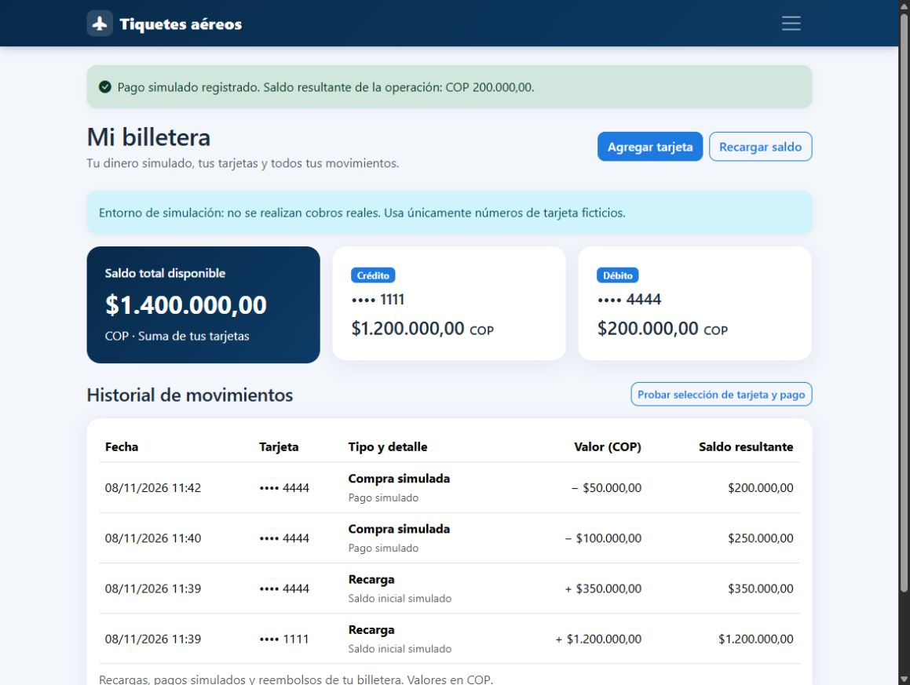

# Verificación de la iteración 2

Fecha: 8 de noviembre de 2026. Repositorio: `C:\Users\miloj\Documents\ChatGPT\Airlock\aerolinea`.

## Resultado automatizado

* Suite inicial: **62 pruebas, todas satisfactorias** antes de modificar el código.
* Suite final: **99 pruebas, todas satisfactorias**: 62 de regresión y 37 nuevas.
* `manage.py check`: sin incidencias.
* `manage.py makemigrations --check --dry-run`: sin cambios pendientes de migración.
* `git diff --check`: sin errores de espacios. Git puede avisar sobre su conversión habitual de LF a CRLF en Windows.
* Migración de un vuelo existente desde `vuelos/0002`: conserva identificación, capacidad y administrador; agrega contadores en cero.

Entorno verificado: Windows, Python 3.14.3, Django 5.2.19 y SQLite. La configuración del proyecto mantiene soporte para PostgreSQL.

## Recorridos en navegador

Se ejecutó el servidor únicamente en `127.0.0.1:8765`, con una base separada en `.qa/visual.sqlite3` y datos ficticios, excluidos de Git.

| Recorrido | Resultado observado |
| --- | --- |
| Visitante: portada | Vuelos nacionales e internacionales con ilustración y datos completos |
| Búsqueda: origen Pereira + costo máximo COP 300.000 | Solo el vuelo correspondiente, con 150 cupos |
| Cliente: panel individual | Dos tarjetas enmascaradas, saldo total e historial |
| Pago simulado de COP 400.000 sobre débito con COP 350.000 | Mensaje de saldo insuficiente; sin descuento |
| Pago simulado de COP 100.000 sobre débito | Saldo débito COP 250.000; crédito permanece en COP 1.200.000; movimiento registrado |
| Pago simulado adicional de COP 50.000 | Saldo débito COP 200.000; total COP 1.400.000; formato numérico colombiano |
| Administrador: edición de precio | Vuelo actualizado de COP 250.000 a COP 260.000, conservando código y horarios |
| Ancho móvil de 390 px | Formularios y billetera adaptados; sin desbordamiento horizontal de la página |
| Navegación adaptable | Menú colapsable funcional; enlaces de búsqueda y billetera según rol |

## Límites de la verificación

No se realizó despliegue ni conexión a una base de producción. No se ejecutaron pruebas de carga concurrente en PostgreSQL ni una auditoría formal WCAG con lectores de pantalla. Las compras/reservas de tiquetes y cancelaciones permanecen en la iteración 3; los reembolsos se validaron en las pruebas del servicio interno. No existe integración de pagos reales.
